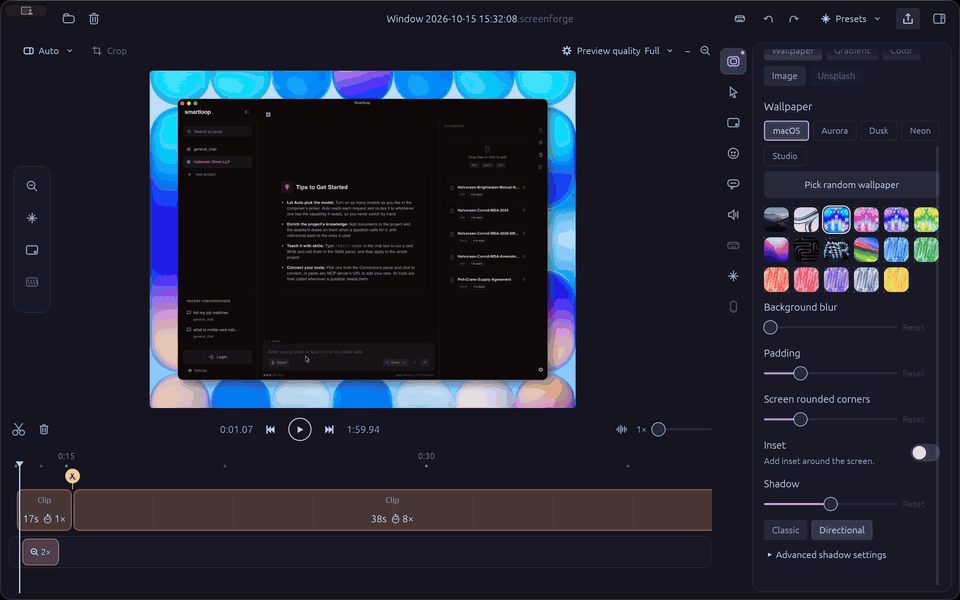

# ScreenForge

[](https://www.rust-lang.org)
[](LICENSE)
[](https://github.com/mehfuzh/screenforge/releases/latest)
[](https://github.com/mehfuzh/screenforge/releases/latest/download/ScreenForge.dmg)
[](https://github.com/mehfuzh/screenforge/actions/workflows/ci.yml)
[](https://github.com/mehfuzh/screenforge/releases/latest)
[](https://github.com/mehfuzh/screenforge/releases/latest)
[](docs/STATUS.md)

Open source macOS screen recorder and timeline editor, written in Rust, for tutorials, product
demos and YouTube. Recordings come out polished: automatic zooms that follow your clicks and
typing, a smooth cursor, backgrounds, and an audio track you can split, trim, move, mute and
speed up on its own. Projects are saved as `.screenforge` packages; Screen Studio projects
(`.screenstudio`) can be imported.



## Download

**[Download ScreenForge for macOS](https://github.com/mehfuzh/screenforge/releases/latest/download/ScreenForge.dmg)**
(Apple silicon, macOS 14 or later; signed and notarized). Open the DMG, drag ScreenForge to
Applications, and grant Screen Recording and Input Monitoring on first launch. All versions are on
the [releases page](https://github.com/mehfuzh/screenforge/releases); the website is
[screenforge.studio](https://screenforge.studio).

**Linux (x86_64):** [.deb](https://github.com/mehfuzh/screenforge/releases/latest/download/screenforge_amd64.deb)
(`sudo apt install ./screenforge_amd64.deb`) or a portable
[.tar.gz](https://github.com/mehfuzh/screenforge/releases/latest/download/ScreenForge-linux-x86_64.tar.gz).
ffmpeg is included. Editing and exporting work everywhere; system audio and typing-caret zooms
are macOS-only.

**Homebrew (macOS and Linux):** `brew install zot24/tap/screenforge` installs the same builds
(the app into /Applications on a Mac, a `screenforge` command on Linux), and `brew upgrade`
picks up new releases a few hours after they are published.

Recording works on **X11 and Wayland** sessions. On Wayland (GNOME, KDE Plasma and other
desktops with an xdg-desktop-portal backend) the first recording asks you to pick a screen in
the system's "Share your screen" dialog; ScreenForge remembers the choice and only asks again
when you record on a different monitor. To record a window, pick it in the same dialog's
Window tab (Wayland does not let apps list other windows). The app's own windows run on
XWayland. On Wayland the cursor is recorded as part of the video and clicks and keystrokes
are not recorded, so automatic zooms and cursor effects are not available there yet.

If the dialog never appears or recording reports that no ScreenCast portal was found (common
after switching between desktops), restart the portal: `systemctl --user restart xdg-desktop-portal`.

**Pricing:** recording and editing are free and open source (Apache-2.0), and so are your first
three exports. After that, exporting from the official build needs a license: US$29
once (lifetime, no subscription), verified offline. It is Apache-2.0 code, so you can always build it yourself and
remove the gate; the license pays for the maintained, signed and notarized download, the CI that
builds it, and ongoing maintenance. See `backend/README.md` for how keys are issued.

> Status: early alpha. Records the screen with ScreenCaptureKit (plus an optional webcam), edits on a GPU-rendered
> timeline (cuts, speed, zooms that follow the cursor, smoothed cursor, backgrounds, padding,
> shadow, camera layouts, captions transcribed on device with Whisper) and exports MP4/HEVC/ProRes/GIF/WebM with mixed audio, background
> music and an independent audio track. See `docs/STATUS.md` for what is missing.

## Product roadmap

Controls for these show up greyed out in the app (hover: "on the product roadmap") rather than half-working:

- **Masks and highlights** — blur or hide regions, spotlight areas
- **Crop editing** — the Crop tool in the preview toolbar
- **Keyboard shortcut overlay** — key-cap rendering of recorded keystrokes
- **Device frames** — iPhone/iPad recording and mockup frames
- **Unsplash backgrounds** — online wallpaper search
- **Face tracking and color grading** — camera centring, looks and LUTs

## Layout

| crate | purpose |
|---|---|
| `crates/sf-project`  | `.screenforge` package model (and `.screenstudio` import): superjson envelope, v4 schema, v3→v4 migration, recording metadata, input event logs |
| `crates/sf-engine`   | timeline (output↔source time), react-spring compatible springs, cursor smoothing, zoom camera, layout, auto zoom |
| `crates/sf-media`    | ffmpeg-driven decode (HLS fMP4 → RGBA) and encode (rawvideo → H.264/HEVC/ProRes/GIF/WebM + audio mix) |
| `crates/sf-render`   | wgpu compositor (WGSL): background, shadow, rounded screen, camera, cursor sprites |
| `crates/sf-session`  | an opened project: sources, caches, per-frame `FrameDesc` |
| `crates/sf-export`   | headless export loop |
| `crates/sf-recording`| recorder (ScreenCaptureKit, webcam, input events, cursor capture) writing the polyrecorder layout |
| `apps/studio`        | egui desktop app (launcher, editor, export) |
| `apps/sf-cli`        | `sf inspect | frame | export | resave` |

## Requirements

- macOS 14+ on Apple silicon, Rust stable. The app bundle ships its own ffmpeg; for
  `cargo run`, `ffmpeg` on PATH is used.
- Linux: Rust stable plus `pkg-config libgtk-3-dev libasound2-dev libxkbcommon-dev libx11-dev
  libxtst-dev libxi-dev libxcursor-dev libxrandr-dev libpipewire-0.3-dev libclang-dev` and
  `ffmpeg`; `scripts/bundle-linux.sh` builds the `.deb` and `.tar.gz`.
- Built-in wallpapers and music live in `assets/` (generated by `scripts/gen-wallpapers.py`
  and `scripts/gen-music.py`); the desktop's own wallpapers appear as
  their own category: macOS on a Mac, the distribution's (e.g. Ubuntu) on Linux.
- To try camera layouts with a project that has no webcam channel, set
  `SF_DEBUG_CAMERA=/path/to/clip.mp4` (e.g. `ffmpeg -f lavfi -i testsrc=size=640x480:rate=30 -t 60 cam.mp4`).

## Try it

```sh
cargo run -p sf-cli -- inspect "My Recording.screenforge"
cargo run -p sf-cli -- frame   "…/My Recording.screenforge" --at-ms 12000 -o frame.png
cargo run -p sf-cli -- export  "…/My Recording.screenforge" -o out.mp4 --fps 60 --height 1080
cargo run -p sf-cli -- import  "…/My Recording.screenstudio"   # copy to ~/ScreenForge Projects
cargo run -p studio -- "…/My Recording.screenforge"   # editor
cargo run -p studio                                      # recording picker
```

The app needs Screen Recording and Input Monitoring permissions (System Settings →
Privacy & Security) for the process that runs it (your terminal when using `cargo run`).

Editor shortcuts: Space play/pause · ←/→ frame · ⇧←/→ second · S split · ⌫ delete clip ·
⌘Z/⌘⇧Z undo/redo · ⌘S save · ⌘E export · ⌘+wheel zoom timeline.

## License

Apache-2.0. See `LICENSE`.

## Releasing

`scripts/setup-release.sh` stores notarization credentials once (verified with Apple). Then
`scripts/release.sh 0.1.0` builds, signs with the Developer ID in the keychain, notarizes,
staples, makes the DMG and creates the GitHub Release, all from this Mac. No App Store record is
involved (Developer ID distribution). `scripts/setup-release.sh --ci` additionally exports the
certificate and sets the secrets for `.github/workflows/release.yml`, if releases should run on
Actions instead.

## Third-party software in the app bundle

The app bundles statically linked `ffmpeg` and `ffprobe` binaries from
[ffmpeg.martin-riedl.de](https://ffmpeg.martin-riedl.de) (GPL builds of FFmpeg, run as separate
processes). FFmpeg is licensed under the GPL/LGPL; its source is available from ffmpeg.org.
`scripts/fetch-ffmpeg.sh` downloads them at bundle time.
